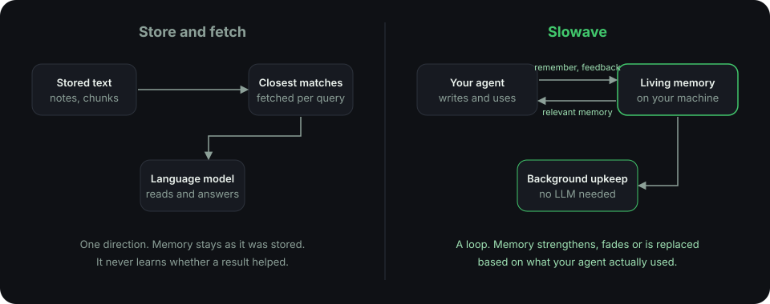

## Slowave is not a search index with a model on top

Many memory tools work like a library. They store text, fetch the closest matches for a question, and hand them to a language model. This approach, often called RAG, is excellent for searching documents and knowledge bases.

Slowave does a different job. It is a **living memory** that changes as your agent works.

<Frame caption="A one-way store-and-fetch pipeline versus a memory that learns from use.">
  
</Frame>

<CardGroup cols={2}>
  <Card title="It learns from use" icon="trending-up">
    Your agent reports which memories helped. Helpful ones come back more often. Unhelpful ones fade.
  </Card>
  <Card title="It keeps itself current" icon="refresh-cw">
    A newer decision replaces an older one. A plain store would return both and leave your agent to guess.
  </Card>
  <Card title="It captures how, not only what" icon="list-checks" href="/procedures">
    Besides facts, it saves methods that worked, as [procedures](/procedures).
  </Card>
  <Card title="Its upkeep needs no model" icon="cpu">
    Tidying, ranking and recall run locally with no LLM calls. No separate model sits behind your memory.
  </Card>
</CardGroup>

Your agent's own model still does the reasoning. Slowave keeps memory and reasoning separate: Slowave decides what is worth remembering and recalling, and your agent decides what to do with it.

<Note>
  Slowave and document search work well together. Use search for large reference material. Use Slowave for the decisions, rules and lessons that build up as you work.
</Note>

## Compared to other ways of giving an agent context

| | Rules files (like `CLAUDE.md`) | Search over stored text (RAG) | Hosted memory services | Slowave |
| --- | --- | --- | --- | --- |
| **Who writes memory** | You | You index your content | The service | Your agent, with your review |
| **Where it lives** | Your repo | Wherever you host it | A cloud service | Your computer |
| **Shared between tools** | Per tool | Depends on setup | Usually | Yes |
| **Gets better with use** | No | Typically no | Varies | Yes, from agent feedback |
| **Replaces outdated information** | By hand | By re-indexing | Varies | Yes |
| **Saves reusable methods** | No | No | Rarely | Yes, as procedures |
| **Needs an account or key** | No | Often | Usually | No |
| **Best for** | Stable team conventions | Searching documents | Apps with many end users | Your own coding workflow |

<Tip>
  They work well together. Keep stable team rules in a rules file. Let Slowave handle the decisions and lessons that build up as you work.
</Tip>

## When Slowave is a good fit

- You use one or more coding agents every day.
- You are tired of repeating yourself.
- You want your memory to stay on your own machine.

## When it is not

- You need memory for end users of a product you ship. Slowave is for developers using coding agents.
- You need encrypted storage out of the box.

## Early results

We test how well Slowave finds the right information in long conversation histories.

| Test | Result |
| --- | --- |
| LoCoMo, all questions | 71.84% |
| LoCoMo, questions spanning several sessions | 87.04% |
| LongMemEval, updated facts | 83.33% |

<Warning>
  These are early results. They measure whether the right evidence was found, not whether a coding agent finished its task better. We do not rank Slowave against other systems.
</Warning>

<Card title="Read the code" icon="github" href="https://github.com/slowave-ai/slowave" horizontal>
  Slowave is open source under AGPL-3.0-or-later. A commercial license is available on request.
</Card>
