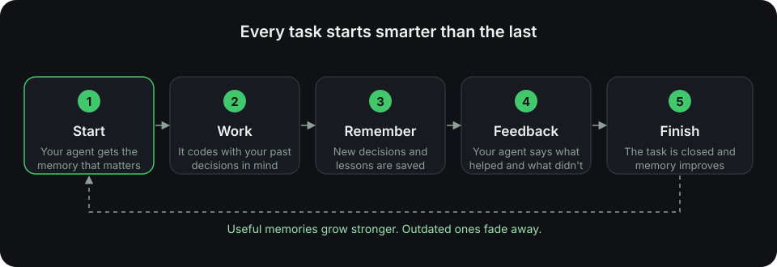

Think of Slowave as a notebook your agent reads before each task and writes in afterwards. Over time, the notebook keeps what helps and lets the rest fade.

<Frame caption="The Slowave loop. Your agent drives it. You don't have to.">
  
</Frame>

## The five steps

<Steps>
  <Step title="Start">
    When a task begins, your agent asks Slowave what it should know. Slowave replies with a short list of relevant memories.
  </Step>
  <Step title="Work">
    Your agent codes with those memories in mind. It can ask again if it needs more detail.
  </Step>
  <Step title="Remember">
    When your agent learns something durable, like a decision or a rule, it saves it.
  </Step>
  <Step title="Give feedback">
    Your agent says which memories helped and which did not. This is how Slowave learns what is useful.
  </Step>
  <Step title="Finish">
    The task closes. If your agent found a good way of working, Slowave keeps it as a [procedure](/procedures) for next time.
  </Step>
</Steps>

<Tip>
  You don't run these steps yourself. `slowave setup` teaches each connected agent to do them.
</Tip>

## What happens in the background

Between tasks, Slowave tidies up. Useful memories get stronger. Duplicates merge. Outdated memories fade or are replaced by newer ones.

This all happens on your computer, with no LLM calls and no API key. The ideas are [inspired by how the brain remembers](/inspired-by-the-brain).

## The five tools, in plain words

| Your agent says | What it means |
| --- | --- |
| **Activate** | "I'm starting a task. What should I know?" |
| **Remember** | "Save this for later." |
| **Recall** | "I need more detail on this." |
| **Feedback** | "This helped. That didn't." |
| **Commit** | "The task is done. Here's what happened." |

These are the five tools Slowave offers through MCP, a standard way for agents to use tools. The [reference page](/reference-lite) lists them.

<Card title="Next: install it" icon="arrow-right" href="/quickstart" horizontal>
  It takes about five minutes.
</Card>
