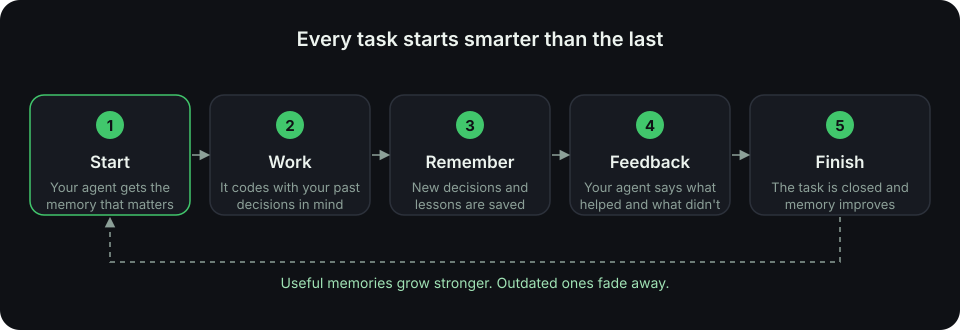

<Frame caption="Slowave runs beside your coding agents and keeps what matters.">
  
</Frame>

## Tell your agent once. It remembers.

Every new coding session starts from zero. You explain your conventions again, and you repeat the decision you made last week.

Slowave fixes that. It gives your agents a shared memory that lives on your computer. A rule you state once shows up in the next task, even in a different agent.

<CardGroup cols={3}>
  <Card title="Quickstart" icon="rocket" href="/quickstart">
    Install in about five minutes.
  </Card>
  <Card title="See it work" icon="eye" href="/see-it-work">
    Watch a rule survive from one session to the next.
  </Card>
  <Card title="How it works" icon="workflow" href="/how-it-works">
    The idea in plain words, with a picture.
  </Card>
</CardGroup>

## Why engineers pick Slowave

<Columns cols={3}>
  <Card title="Local by default" icon="hard-drive">
    Your memory stays on your computer. Nothing goes to a hosted memory service.
  </Card>
  <Card title="No API key" icon="key-round">
    Slowave runs without any LLM key. There is nothing to sign up for.
  </Card>
  <Card title="Works with your tools" icon="plug">
    One memory shared by Claude Code, Cursor, Codex and more.
  </Card>
  <Card title="Gets better with use" icon="trending-up">
    Memories that help get stronger. Outdated ones fade or get replaced.
  </Card>
  <Card title="Fully visible" icon="layout-dashboard">
    A local dashboard shows what your agent remembers and what it actually used.
  </Card>
  <Card title="Open source" icon="github">
    Free under AGPL-3.0-or-later. Read the code, or run it yourself.
  </Card>
</Columns>

## Choose your path

<CardGroup cols={2}>
  <Card title="I'm new to agent memory" icon="lightbulb" href="/why-slowave">
    Start with the problem Slowave solves.
  </Card>
  <Card title="I want to try it now" icon="terminal" href="/quickstart">
    Install, connect and save your first memory.
  </Card>
  <Card title="I'm picking a tool" icon="scale" href="/compared-to-others">
    See how Slowave compares with rules files and hosted services.
  </Card>
  <Card title="I care about privacy" icon="shield-check" href="/local-and-private">
    See exactly where your data lives.
  </Card>
</CardGroup>

<Note>
  Slowave is public beta software. Settings and storage may change between versions.
</Note>
