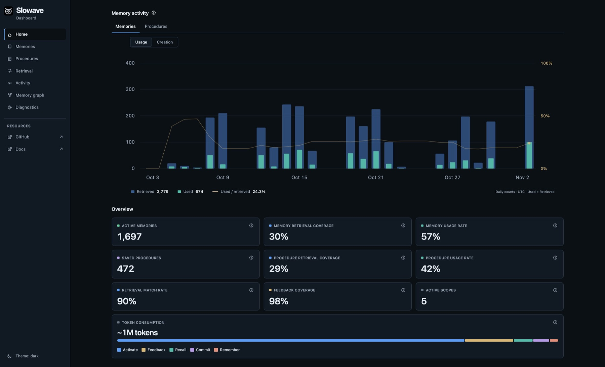

<Frame caption="The Slowave dashboard shows what your agent remembers and what it used. Example data.">
  
</Frame>

## Tell your agent once. It remembers.

Every new coding session starts from zero. You explain your conventions again, and you repeat the decision you made last week.

Slowave is a local MCP memory server. It gives your coding agents one shared memory of your decisions, rules and lessons, and of the methods that worked, which it saves as [procedures](/procedures). A rule you state once shows up in the next task, even in a different agent.

<CodeGroup>

```bash Install
pipx install slowave
```

```bash Connect your agents
slowave setup
```

</CodeGroup>

<CardGroup cols={3}>
  <Card title="Quickstart" icon="rocket" href="/quickstart">
    Install and connect your agent.
  </Card>
  <Card title="See it in action" icon="eye" href="/see-it-in-action">
    Watch a rule survive from one session to the next.
  </Card>
  <Card title="How it works" icon="workflow" href="/how-it-works">
    The idea in plain words, with a picture.
  </Card>
</CardGroup>

## It remembers what, and how

<CardGroup cols={2}>
  <Card title="Memories" icon="brain" href="/memory-model">
    Decisions, rules and lessons. State them once and they come back in the next task.
  </Card>
  <Card title="Procedures" icon="list-checks" href="/procedures">
    Methods that worked. Your agent saves how it did a task well and reuses it for similar work.
  </Card>
</CardGroup>

## Why engineers pick Slowave

<Columns cols={3}>
  <Card title="Local by default" icon="hard-drive">
    Your memory stays on your computer. Nothing goes to a hosted memory service.
  </Card>
  <Card title="No API key" icon="key-round">
    Slowave makes no LLM calls to store, rank or find memories. Your coding agent keeps its own LLM account.
  </Card>
  <Card title="Works with your tools" icon="plug">
    One memory shared by Claude Code, Cursor, Codex and more.
  </Card>
  <Card title="Gets better with use" icon="trending-up">
    Memories that help get stronger. Outdated ones fade or get replaced.
  </Card>
  <Card title="Fully visible" icon="layout-dashboard">
    A local dashboard shows what your agent remembers and what it actually used.
  </Card>
  <Card title="Open source" icon="git-fork">
    Free under AGPL-3.0-or-later. Read the code, or run it yourself.
  </Card>
</Columns>

## Works with your coding agent

<CardGroup cols={4}>
  <Card title="Claude Code" icon="terminal" href="/integrations/claude-code" />
  <Card title="Copilot CLI" icon="sparkles" href="/integrations/copilot-cli" />
  <Card title="Codex" icon="code" href="/integrations/codex" />
  <Card title="Cursor" icon="mouse-pointer-2" href="/integrations/cursor" />
  <Card title="OpenCode" icon="square-terminal" href="/integrations/opencode" />
  <Card title="Windsurf (Devin Desktop)" icon="wind" href="/integrations/windsurf" />
  <Card title="Cline" icon="bot" href="/integrations/cline" />
  <Card title="Antigravity" icon="orbit" href="/integrations/antigravity" />
  <Card title="Claude Desktop" icon="monitor" href="/integrations/claude-desktop" />
</CardGroup>

## Choose your path

<CardGroup cols={2}>
  <Card title="I'm new to agent memory" icon="lightbulb" href="/why-slowave">
    Start with the problem Slowave solves.
  </Card>
  <Card title="I want to try it now" icon="terminal" href="/quickstart">
    Install, connect and save your first memory.
  </Card>
  <Card title="I'm picking a tool" icon="scale" href="/compared-to-others">
    See how Slowave compares with rules files and hosted services.
  </Card>
  <Card title="I care about privacy" icon="shield-check" href="/local-and-private">
    See exactly where your data lives.
  </Card>
</CardGroup>

<Note>
  Slowave is public beta software. Settings and storage may change between versions. Memory is stored as plaintext in a local database, so protect it with your operating system's file permissions or disk encryption. The benchmarks are preliminary and measure evidence retrieval, not end-to-end accuracy.
</Note>
