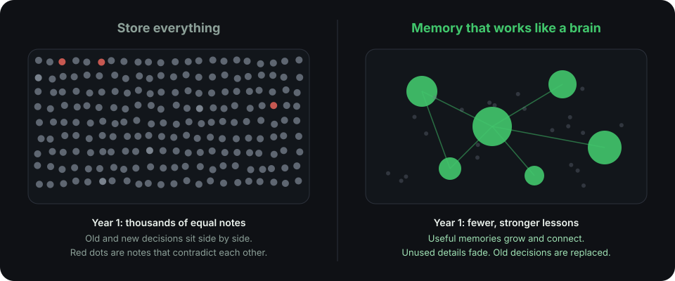

The obvious way to give an agent a memory is to write everything down and search it later. It sounds safe. After a few months, it isn't.

## The filing cabinet problem

Imagine you saved every note from every coding session for a year.

- You asked "how do we handle errors?" in March, and again in July after the team changed its mind.
- Both answers are still in the cabinet, and both look equally important.
- A new search returns forty notes. Some contradict each other. Most don't matter anymore.

Your agent now has to read all of it, guess which notes are current, and decide what to trust. The more you store, the worse it gets.

<Frame caption="After a year, a store-everything memory is noisy. A brain-like memory is smaller and sharper.">
  
</Frame>

## What your brain does differently

You don't remember every sentence of every day. Your brain does something smarter, and it's the reason you stay useful as you collect more experience.

<AccordionGroup>
  <Accordion title="It keeps the lesson, not only the event" icon="graduation-cap" defaultOpen>
    Suppose you hit three different outages caused by the same design mistake. At first you remember each one separately. Over time, you form a general rule: "never design it that way". Later you can use the rule without recalling any single outage.

    A store-everything system keeps three incident notes. A brain-like system also learns the rule.
  </Accordion>
  <Accordion title="It forgets on purpose" icon="eraser">
    Forgetting is not a flaw. Details you never use fade, so the important things stay easy to find. A memory that can't forget slowly drowns in its own history.
  </Accordion>
  <Accordion title="It strengthens what proves useful" icon="trending-up">
    Things you use again and again become easy to recall. Things that never help stay in the background. Use shapes memory.
  </Accordion>
  <Accordion title="It updates itself" icon="refresh-cw">
    When you change your mind, the new belief replaces the old one. You don't carry both and argue with yourself.
  </Accordion>
  <Accordion title="It keeps both the specific and the general" icon="layers">
    You can recall a particular moment, and you also hold general knowledge built from many moments. Keeping the details lets you avoid mixing up similar events. Keeping the patterns lets you handle situations you've never seen.
  </Accordion>
  <Accordion title="It remembers skills, not only facts" icon="list-checks">
    Knowing that something is true is different from knowing how to do it. People build skills by repeating methods that worked.
  </Accordion>
</AccordionGroup>

## How Slowave applies these ideas

<Steps>
  <Step title="Experiences are saved with their context">
    Each task keeps its own details, so similar situations don't get confused.
  </Step>
  <Step title="Related experiences are grouped, and lessons are kept">
    Between tasks, Slowave works quietly in the background. It groups related experiences and keeps the durable lessons.
  </Step>
  <Step title="Useful memories grow stronger">
    Your agent reports which memories helped. Those become more likely to come back.
  </Step>
  <Step title="Unused memories fade, outdated ones are replaced">
    A newer decision retires the older one. Your agent isn't left to choose between two answers.
  </Step>
  <Step title="Skills become procedures">
    A method that worked is saved as a [procedure](/procedures), so your agent can repeat it.
  </Step>
  <Step title="Your agent gets a short brief, not the whole history">
    Like your working memory, the brief holds only what matters for the task at hand.
  </Step>
</Steps>

<Tip>
  The result is a memory that gets more useful as it grows, not slower and noisier.
</Tip>

## Memory and thinking are different jobs

In people, remembering and reasoning work together, but they are not the same thing. Someone can reason well and still forget what happened yesterday.

Slowave follows that split. It handles memory. Your agent's own model does the thinking. That is also why Slowave isn't [a search index with a model on top](/compared-to-others).

<Note>
  This is inspiration, not imitation. Slowave is a practical engineering tool, not a model of the brain. The analogy does not prove that it works. The [early results](/compared-to-others) and your own [dashboard](/see-it-work) are the evidence.
</Note>

<Card title="See it in action" icon="arrow-right" href="/see-it-work" horizontal>
  Watch a rule and a reusable method in two short stories.
</Card>
