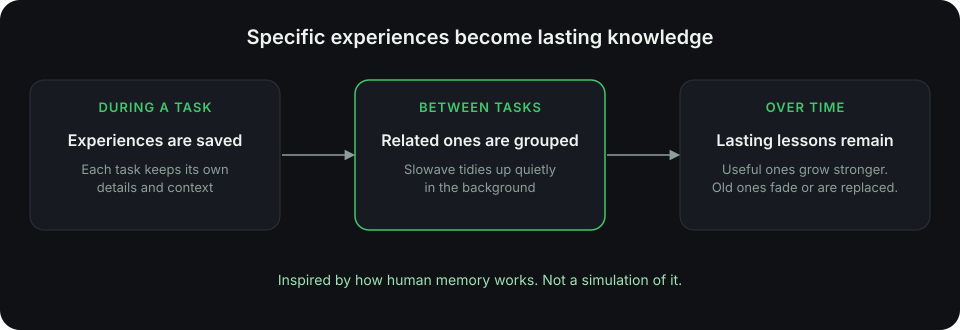

Human memory doesn't record everything. It keeps what you lived through, turns many experiences into lasting knowledge, builds skills, and lets the unhelpful fade. Slowave borrows these ideas for coding agents.

<Frame caption="Slowave's memory works in the same broad spirit.">
  
</Frame>

## The ideas Slowave borrows

| In human memory | In Slowave |
| --- | --- |
| Remembering specific experiences | Each task is saved with its own details and context. |
| Turning many experiences into general knowledge | Related experiences are grouped, and lasting lessons are kept. |
| Learning skills and habits | [Procedures](/procedures): methods that worked, saved for reuse. |
| Tidying memory while you rest | A background worker consolidates memory between tasks. |
| Strengthening what proves useful | Memories your agent reports as helpful become more likely to return. |
| Forgetting and updating | Unused memories fade. Outdated ones are replaced by newer decisions. |
| Holding only what you need right now | Your agent gets a short, relevant brief, not your whole history. |

## Why this matters for you

<CardGroup cols={2}>
  <Card title="Less noise" icon="filter">
    A memory that keeps everything equally becomes clutter. Fading keeps your agent focused.
  </Card>
  <Card title="Lessons, not logs" icon="graduation-cap">
    Three similar incidents become one lesson your agent can apply to a fourth.
  </Card>
  <Card title="Change is normal" icon="refresh-cw">
    People change their minds. Slowave retires old decisions instead of leaving them to contradict new ones.
  </Card>
  <Card title="Memory is not reasoning" icon="split">
    Like in the brain, remembering and thinking are separate jobs. Slowave supplies context. Your agent does the reasoning.
  </Card>
</CardGroup>

<Note>
  This is inspiration, not imitation. Slowave is a practical engineering tool, not a model of the brain. The analogy does not prove that it works. The [early results](/compared-to-others) and your own [dashboard](/see-it-work) are the evidence.
</Note>

<Card title="Next: where your data lives" icon="arrow-right" href="/local-and-private" horizontal>
  Everything stays on your computer.
</Card>
