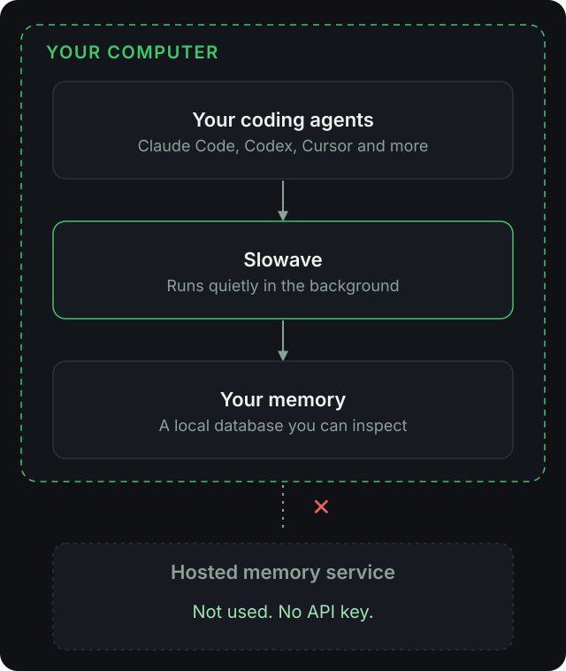
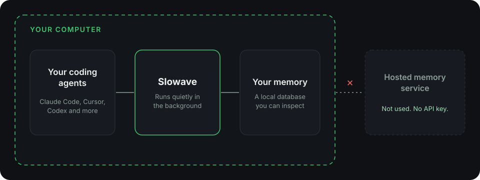

<Frame caption="Your agents, Slowave and your memory all live on your computer.">
  
  
</Frame>

## What stays on your machine

<CardGroup cols={2}>
  <Card title="Your memory" icon="database">
    Saved as one local file in your user data folder. You can move it with the `SLOWAVE_HOME` setting.
  </Card>
  <Card title="The dashboard" icon="layout-dashboard">
    It runs locally and only answers to your own computer.
  </Card>
  <Card title="Memory upkeep" icon="settings">
    Tidying and ranking run locally and use no LLM.
  </Card>
  <Card title="Backups" icon="archive">
    A daily backup is kept on your computer. You can restore it any time.
  </Card>
</CardGroup>

## No LLM API key

Slowave itself never calls an LLM to store or find memories. You need no account and no key for Slowave.

Your coding agent still has its own account with its own provider. Slowave does not change that.

<Info>
  On first use, Slowave downloads a small search model of about 45 MB from Hugging Face. After that, it works offline.
</Info>

## Be honest about the limits

<Warning>
  The local database is **not encrypted** by default. Protect it with your operating system's file permissions or full-disk encryption.
</Warning>

- What your agent saves is whatever your agent decides to save. Review the **Memories** view in the dashboard from time to time.
- Recalled memories are placed in your agent's conversation. Your agent then sends them to its model provider, like any other prompt text.

## Stay in control

<Steps>
  <Step title="Preview before you change anything">
    `slowave setup --dry-run` shows what setup will change.
  </Step>
  <Step title="Remove the connections, keep your memory">
    `slowave uninstall`
  </Step>
  <Step title="Remove everything">
    `slowave purge` deletes your memory data too. It can't be undone.
  </Step>
</Steps>
