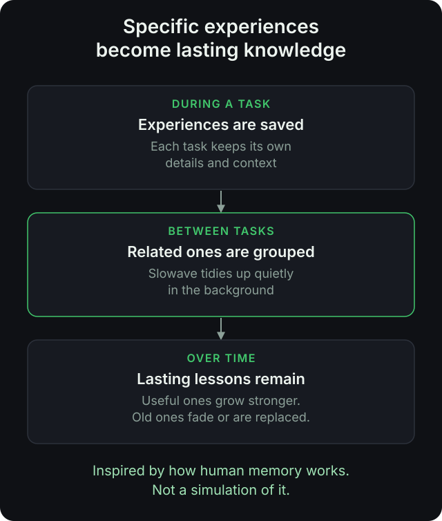
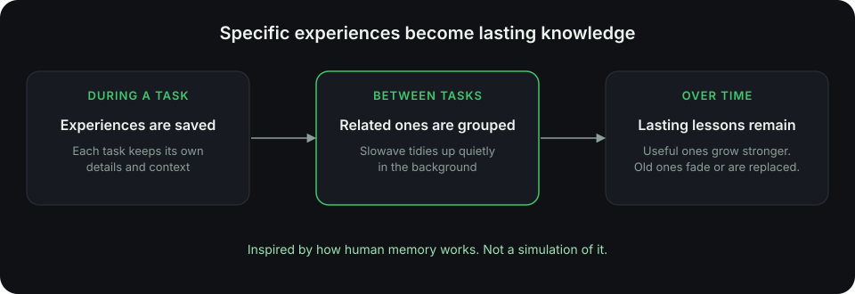

## What gets saved

Slowave keeps things that will help in a future task. It does not keep a transcript of everything.

<CardGroup cols={2}>
  <Card title="Decisions" icon="git-branch">
    "We chose Postgres over MySQL because of JSON support."
  </Card>
  <Card title="Rules and constraints" icon="ruler">
    "Never call the billing service from tests."
  </Card>
  <Card title="Preferences" icon="sliders-horizontal">
    "Use small commits with clear messages."
  </Card>
  <Card title="Lessons" icon="graduation-cap">
    "The build fails if you skip the codegen step."
  </Card>
</CardGroup>

<Card title="Procedures are a separate, key feature" icon="list-checks" href="/procedures" horizontal>
  Besides these facts, your agent saves methods that worked, such as the steps for adding a new endpoint. Learn how procedures work.
</Card>

## Memories are organized by project

Each memory belongs to a **scope**, usually one project. When you work in a project, your agent sees that project's memories, not those from unrelated work.

## Memories change over time

<Frame caption="Specific experiences become lasting lessons. Useful ones grow stronger and old ones fade.">
  
  
</Frame>

<Steps>
  <Step title="Helpful memories grow stronger">
    When your agent reports that a memory helped, it is more likely to appear again.
  </Step>
  <Step title="Unused memories fade">
    Memories that never help slowly drop down the list.
  </Step>
  <Step title="Outdated memories are replaced">
    When your agent saves a newer decision and reports the older one as stale, the old memory is marked as replaced.
  </Step>
</Steps>

<Tip>
  You can see all of this in the [dashboard](/see-it-in-action). Nothing happens out of sight.
</Tip>

## What Slowave does not do

<AccordionGroup>
  <Accordion title="It does not read your whole codebase">
    Your agent already does that. Slowave stores the reasons behind the code, not the code itself.
  </Accordion>
  <Accordion title="It does not guess">
    Slowave saves what your agent chooses to save. Quality depends on your agent giving honest feedback.
  </Accordion>
</AccordionGroup>

<Card title="Next: where your data lives" icon="arrow-right" href="/local-and-private" horizontal>
  Everything stays on your computer.
</Card>
