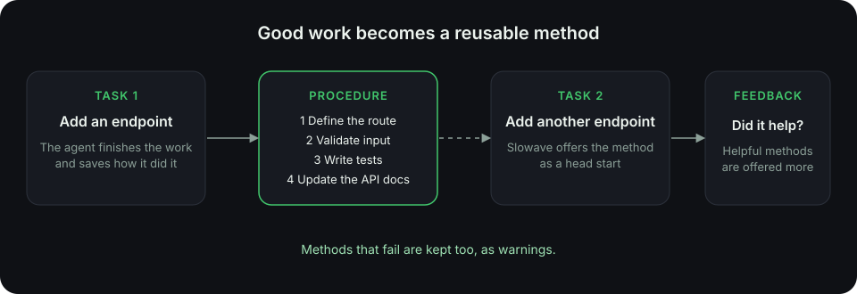
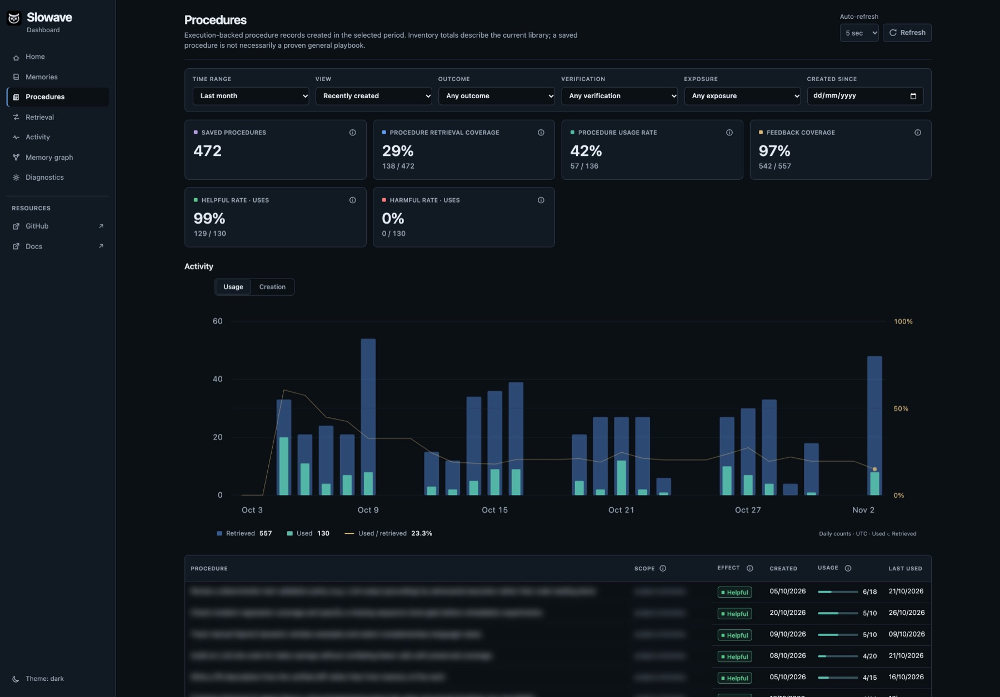

Most memory tools store facts. Slowave also stores **procedures**: the ordered steps that worked the last time your agent did a kind of task.

<Frame caption="From one finished task to a method your agent can reuse.">
  
</Frame>

## Facts tell your agent what. Procedures tell it how.

<CardGroup cols={2}>
  <Card title="Memories" icon="brain">
    What is true: decisions, rules, preferences and lessons.

    *"Errors always use the `{ code, message }` format."*
  </Card>
  <Card title="Procedures" icon="list-checks">
    How something was done: steps, context and warnings from a task that worked.

    *"Add an endpoint: define the route, validate input, write tests, update the API docs."*
  </Card>
</CardGroup>

## How a procedure is born

<Steps>
  <Step title="Your agent finishes a task">
    It closes the task and, if it used a method worth keeping, saves it.
  </Step>
  <Step title="Slowave stores the method">
    A procedure has a goal, ordered steps, the situation it applies to, and any warnings.
  </Step>
  <Step title="A similar task comes along">
    When your agent starts a related task, Slowave offers the procedure as a head start.
  </Step>
  <Step title="Your agent rates it">
    Did it help? Procedures that keep helping are offered more often.
  </Step>
</Steps>

## What a procedure looks like

<Accordion title="Example: shipping a hotfix" icon="flame">
  **Goal:** Ship a fix to production without a full release.

  1. Branch from the last release tag.
  2. Apply the fix and run the full test suite.
  3. Open a pull request against the release branch.
  4. After approval, merge and run the deploy pipeline.
  5. Watch error rates for 15 minutes.

  **Watch out:** Don't merge without at least one reviewer's approval.
</Accordion>

## Good to know

<AccordionGroup>
  <Accordion title="Procedures are advice, not orders">
    Your agent decides what to do. A procedure is evidence from past work to reason about, not a script to run blindly.
  </Accordion>
  <Accordion title="Failures are kept as warnings">
    If a method didn't work, Slowave keeps it and labels it as a caution. Your agent learns what to avoid.
  </Accordion>
  <Accordion title="You can see every procedure">
    The **Procedures** view in the dashboard lists them, with when each was offered and whether it helped.
  </Accordion>
</AccordionGroup>

<Frame caption="The Procedures view in the dashboard. Example data.">
  
</Frame>

<Card title="Next: where your data lives" icon="arrow-right" href="/local-and-private" horizontal>
  Everything stays on your computer.
</Card>
