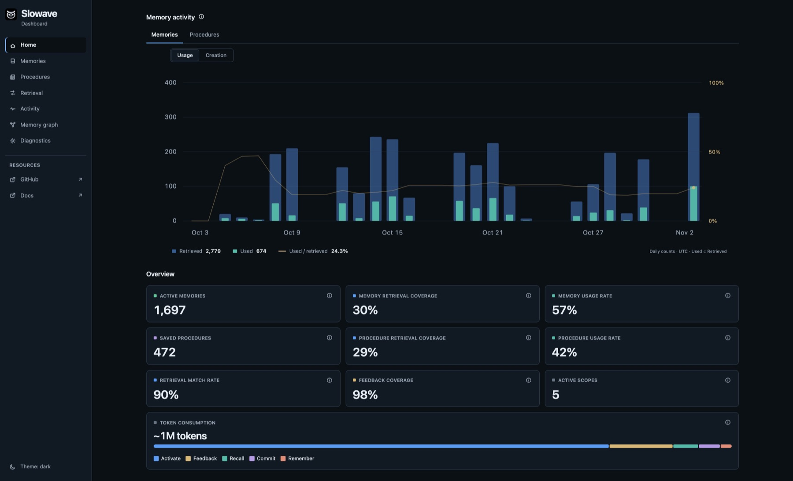
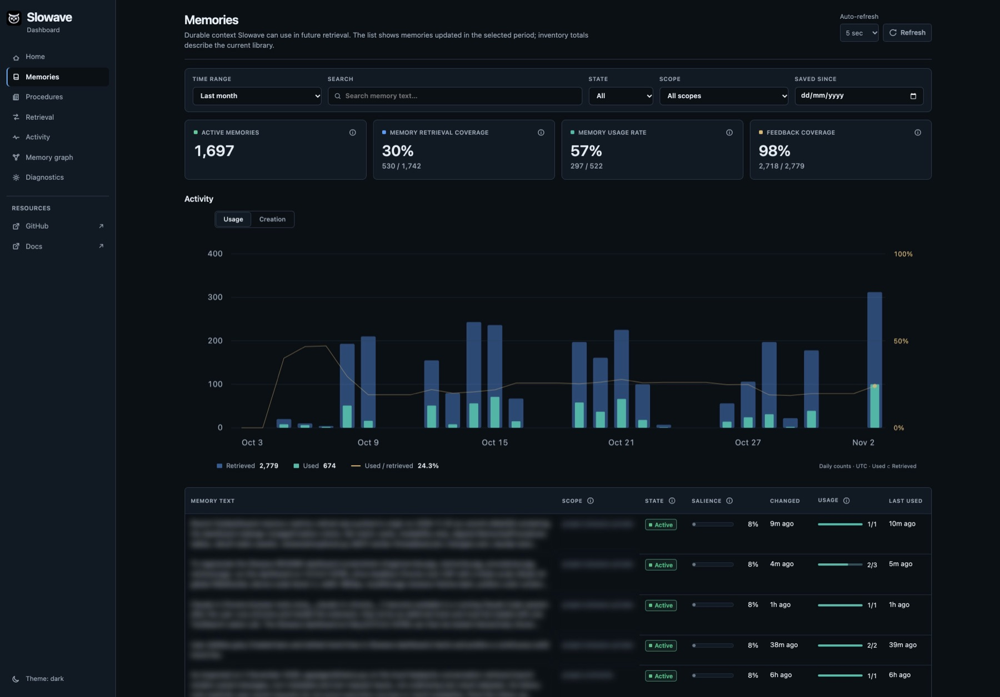
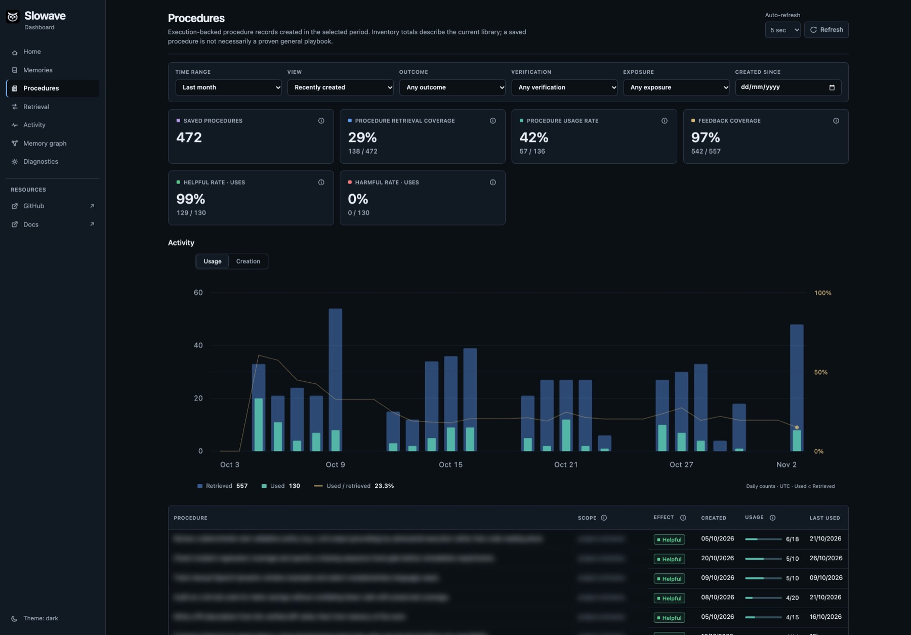
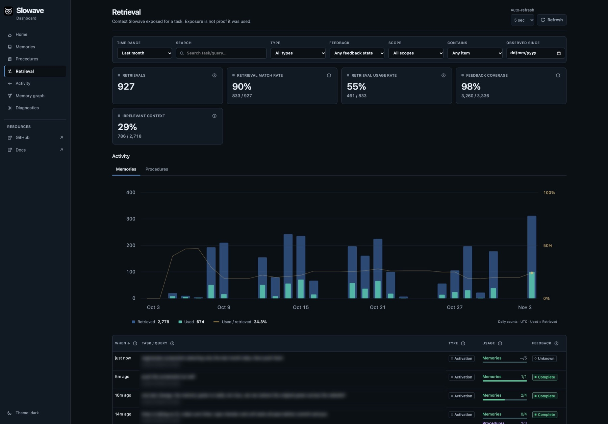
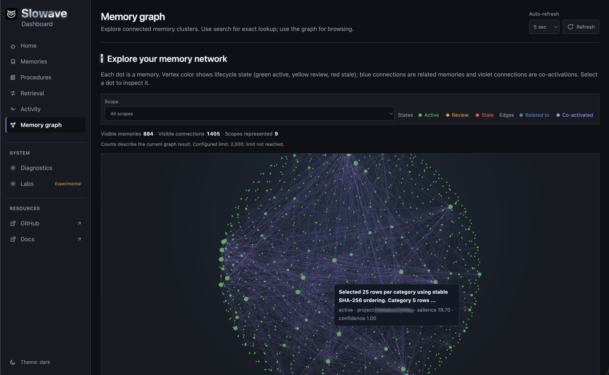
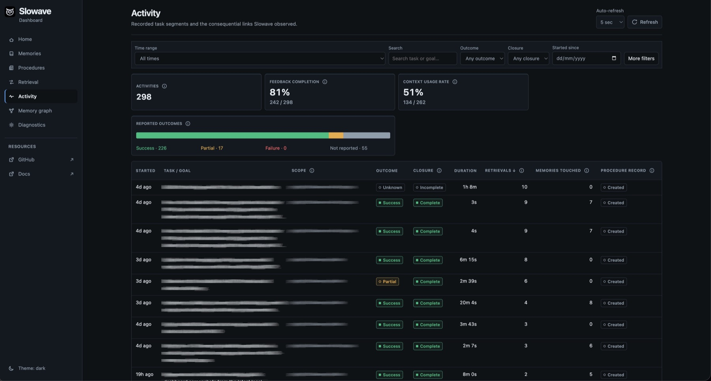

Here are two short illustrative stories from one project. A developer builds a task-tracker API with a coding agent over several sessions. The screenshots further down are example data from a local dashboard.

<Tabs>
  <Tab title="Use case 1: a rule">
    ## Say a rule once

    <Steps>
      <Step title="Session 1: state the rule">
        The developer says: "All API errors must return `{ code, message }`." The agent builds the first endpoint and saves the rule as a memory.
      </Step>
      <Step title="Session 2: it just knows">
        In a brand new session, the agent adds a second endpoint. Its errors already use `{ code, message }`. Nobody repeated the rule.
      </Step>
      <Step title="Session 3: the rule changes">
        The team moves to a standard error format. The developer says so once. The old rule is retired, and new endpoints use the new format.
      </Step>
    </Steps>

    <Check>
      You say it once, and your agent keeps it until you change it.
    </Check>
  </Tab>
  <Tab title="Use case 2: a method">
    ## Your agent learns how you work

    <Steps>
      <Step title="Task 1: the agent works it out">
        Asked to add `POST /tasks`, the agent figures out a good routine: define the route, validate the input, write tests, update the API docs. The tests pass and the task is finished.
      </Step>
      <Step title="The method is saved as a procedure">
        When the agent closes the task, it saves that routine as a [procedure](/procedures), with its steps and a warning: "Run the migration before the tests."
      </Step>
      <Step title="Task 2: Slowave offers it">
        Weeks later, in a new session, the developer asks for `GET /tasks/{id}`. As the task starts, Slowave offers the saved procedure. The agent follows the same routine and skips the trial and error.
      </Step>
      <Step title="The agent rates it">
        The agent reports that the procedure helped. It will be offered more readily for similar work. If it had gone wrong, Slowave would keep it as a warning instead.
      </Step>
    </Steps>

    <Check>
      Your agent doesn't only remember facts. It remembers how to do the job.
    </Check>

    <Accordion title="What the saved procedure looks like" icon="list-checks">
      **Goal:** Add an API endpoint.

      1. Define the route.
      2. Validate the input.
      3. Run the migration, then write the tests.
      4. Update the API docs.

      **Watch out:** Run the migration before the tests.
    </Accordion>

    <Card title="Learn how procedures work" icon="arrow-right" href="/procedures" horizontal>
      What a procedure is, and how it improves with use.
    </Card>
  </Tab>
</Tabs>

## Look inside with the dashboard

Run `slowave dashboard` to open it. Everything shown stays on your computer.

<Tabs>
  <Tab title="Overview">
    <Frame caption="How much your agent recalled, and how useful it was.">
      
    </Frame>
  </Tab>
  <Tab title="Memories">
    <Frame caption="Everything your agent has saved, in one searchable list.">
      
    </Frame>
  </Tab>
  <Tab title="Procedures">
    <Frame caption="Methods your agent learned and can reuse.">
      
    </Frame>
  </Tab>
  <Tab title="Retrieval">
    <Frame caption="What was asked, what came back, and whether it helped.">
      
    </Frame>
  </Tab>
  <Tab title="Graph">
    <Frame caption="How your memories connect to each other.">
      
    </Frame>
  </Tab>
  <Tab title="Activity">
    <Frame caption="A timeline of what happened and when.">
      
    </Frame>
  </Tab>
</Tabs>

The dashboard also has a **System** view that shows whether your memory, background worker and backups are healthy.

<Card title="Next: connect your agent" icon="arrow-right" href="/integrations/overview" horizontal>
  Pick your tool and finish setup.
</Card>
