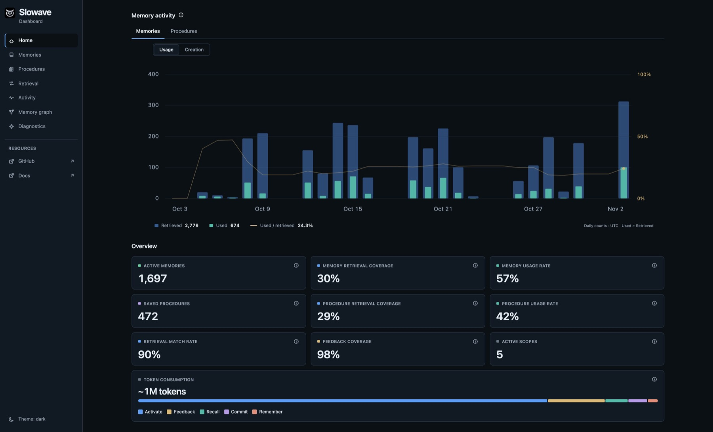
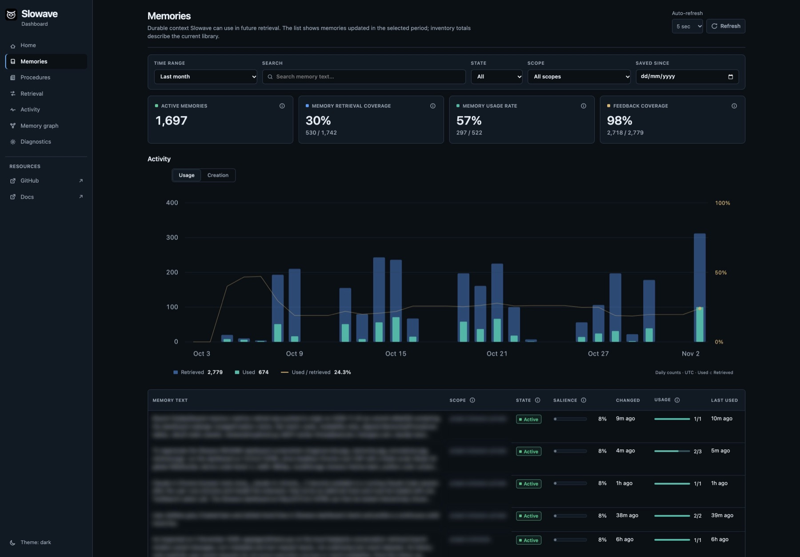
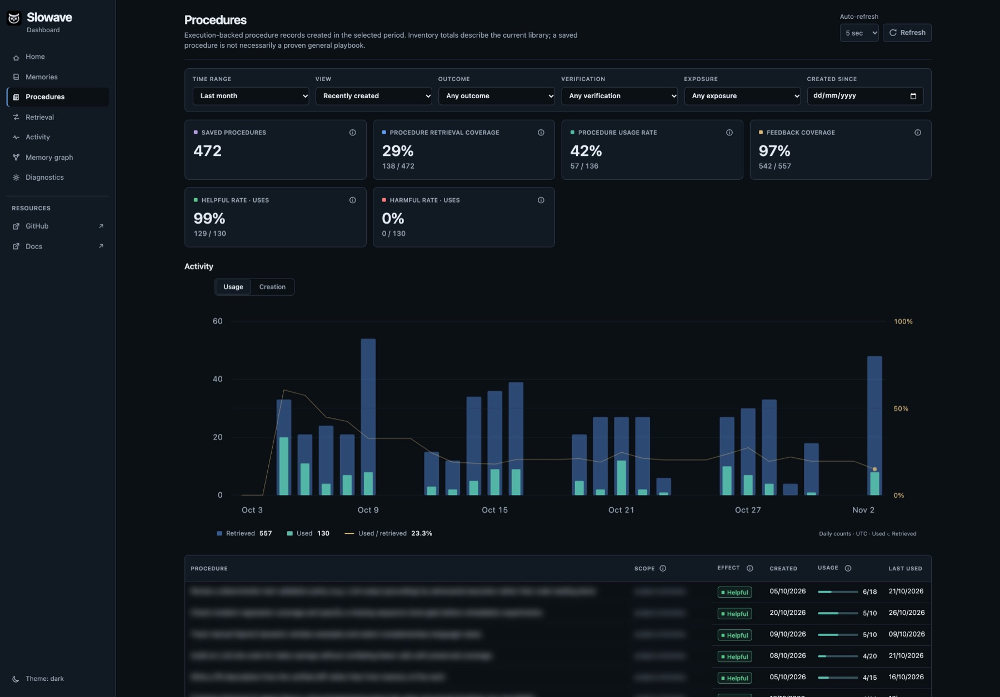
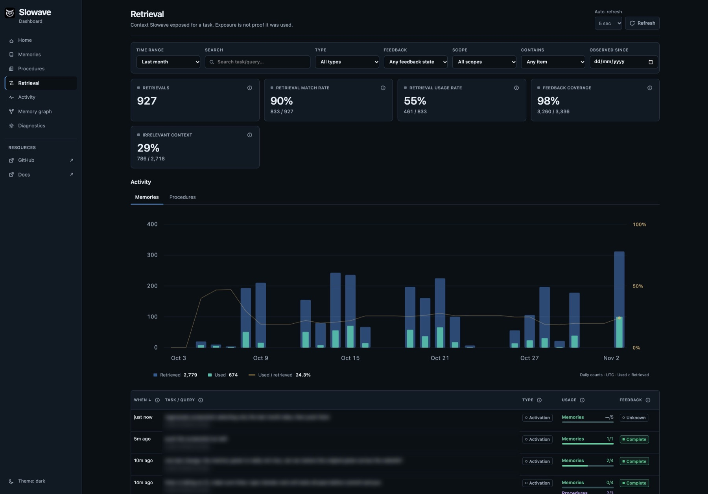
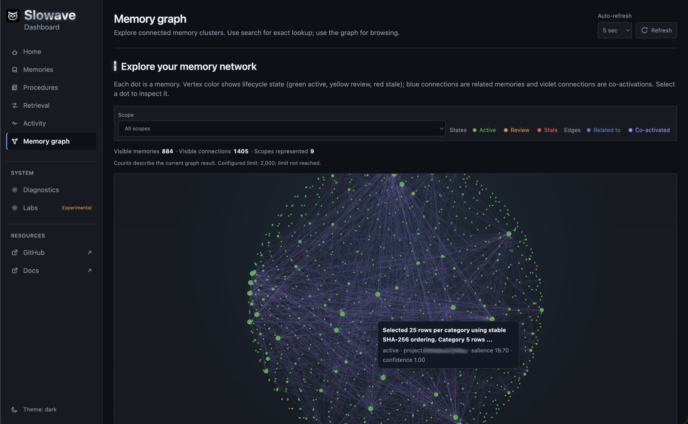
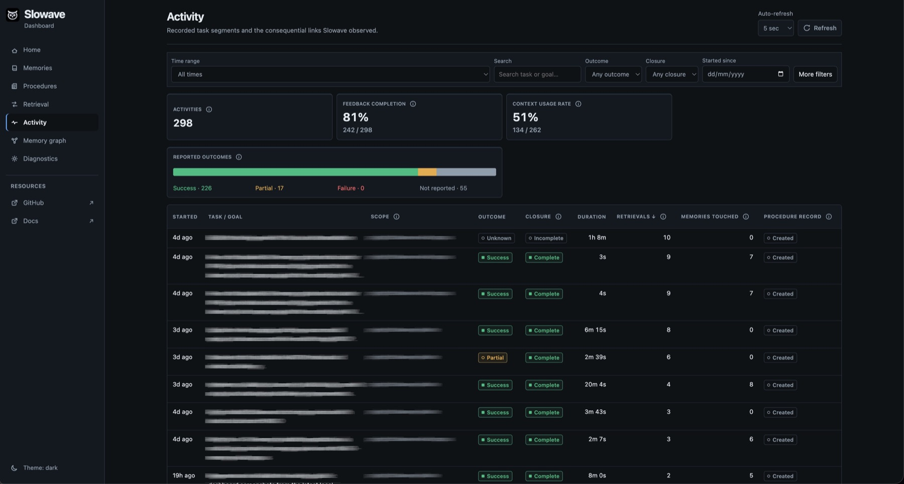

Here is a short story. A developer builds a task-tracker API with a coding agent over four sessions. The screenshots below are example data from a local dashboard.

## The story

<Steps>
  <Step title="Session 1: state a rule once">
    The developer says: "All API errors must return `{ code, message }`." The agent builds the first endpoint and saves the rule as a memory.
  </Step>
  <Step title="Session 2: it just knows">
    In a brand new session, the agent adds a second endpoint. Its errors already use `{ code, message }`. Nobody repeated the rule.
  </Step>
  <Step title="Session 3: a method is reused">
    After the first endpoint, the agent saved how it worked: define the route, validate input, write tests, update the docs. For the next endpoint, Slowave offers that [procedure](/procedures) and the agent follows it.
  </Step>
  <Step title="Session 4: the rule changes">
    The team moves to a standard error format. The developer says so once. The old rule is retired, and new endpoints use the new format. Older endpoints are left alone.
  </Step>
</Steps>

<Check>
  This is the core promise: you say it once, and your agent keeps it until you change it.
</Check>

## Look inside with the dashboard

Run `slowave dashboard` to open it. Everything shown stays on your computer.

<Tabs>
  <Tab title="Overview">
    <Frame caption="How much your agent recalled, and how useful it was.">
      
    </Frame>
  </Tab>
  <Tab title="Memories">
    <Frame caption="Everything your agent has saved, in one searchable list.">
      
    </Frame>
  </Tab>
  <Tab title="Procedures">
    <Frame caption="Methods your agent learned and can reuse.">
      
    </Frame>
  </Tab>
  <Tab title="Retrieval">
    <Frame caption="What was asked, what came back, and whether it helped.">
      
    </Frame>
  </Tab>
  <Tab title="Graph">
    <Frame caption="How your memories connect to each other.">
      
    </Frame>
  </Tab>
  <Tab title="Activity">
    <Frame caption="A timeline of what happened and when.">
      
    </Frame>
  </Tab>
</Tabs>

The dashboard also has a **System** view that shows whether the database, background worker and backups are healthy.

<Card title="Next: connect your agent" icon="arrow-right" href="/integrations/overview" horizontal>
  Pick your tool and finish setup.
</Card>
