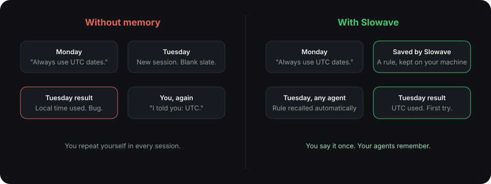

## Your agent is brilliant and forgetful

An AI coding agent knows your code. It does not know why the code looks the way it does.

It does not remember that you ruled out a library last week. It does not remember the naming rule your team agreed on. When you open a new session, it all disappears.

So you explain it again. And again.

<Frame caption="The same rule, with and without memory.">
  
</Frame>

## What changes with Slowave

<CardGroup cols={2}>
  <Card title="You stop repeating yourself" icon="repeat">
    State a constraint once. The next task already knows it.
  </Card>
  <Card title="You can switch agents" icon="arrow-left-right">
    Start in one agent and continue in another. The memory comes along.
  </Card>
  <Card title="Decisions can change" icon="refresh-cw">
    When a rule changes, the old one is retired. Your agent follows the new one.
  </Card>
  <Card title="Good methods get reused" icon="list-checks" href="/procedures">
    A way of working that succeeded once is saved as a procedure and offered again for similar tasks.
  </Card>
</CardGroup>

## What Slowave is not

<AccordionGroup>
  <Accordion title="It is not a reasoning engine">
    Slowave does not make your agent smarter at thinking. It makes sure your agent has the right context.
  </Accordion>
  <Accordion title="It cannot remember what was never saved">
    Memory depends on your agent saving things worth keeping. The more you use it, the better it gets.
  </Accordion>
  <Accordion title="It adds a little overhead">
    Recalled memory takes space in your agent's context. The dashboard shows a rough estimate.
  </Accordion>
</AccordionGroup>

<Card title="Next: see how it works" icon="arrow-right" href="/how-it-works" horizontal>
  The whole idea in one picture.
</Card>
